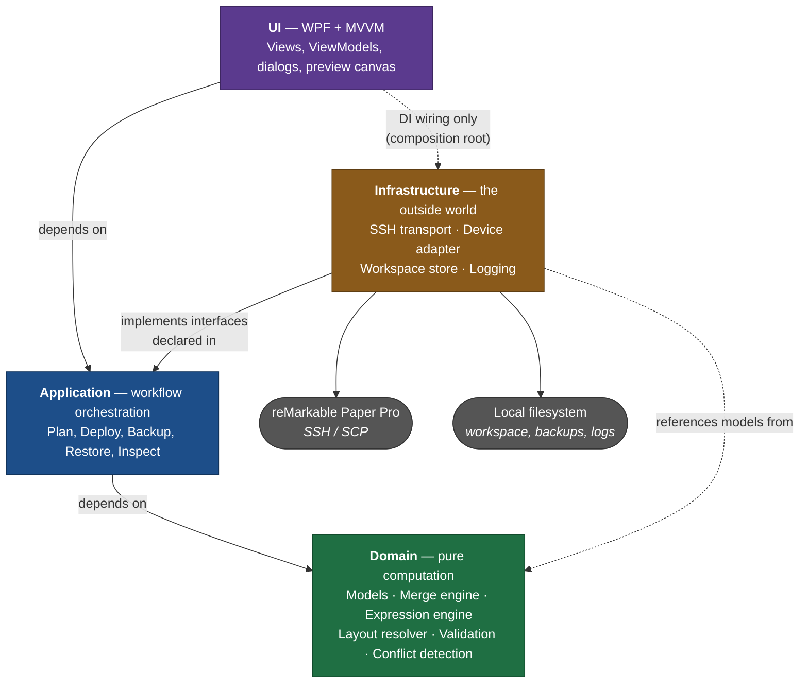

# Architecture Overview

*Status: **Proposed** — awaiting review and approval.*
*Version 0.1 · 2026-10-16 · Supersedes the architecture sections embedded in `PRD.md` §10.4.*

This document is the architectural contract for rM Template Manager. It exists to be
reviewed and approved **before** implementation begins. Individual decisions live as
[ADRs](decisions/) so that each one can be argued, accepted, or reversed on its own.

**The document set, and what each one answers:**

| Document | Question it answers |
|---|---|
| `PRD.md` | What are we building, and for whom? |
| This document | How is the system structured? |
| [ADRs](decisions/) | Which technologies and structures, and *why*? |
| [`coding-standards.md`](../coding-standards.md) | How is code in this repository written? |

Each is maintained separately and on its own cadence. Keeping them apart is deliberate —
see [ADR-0001](decisions/0001-record-architecture-decisions.md).

---

## 1. What we are building

A Windows desktop application that manages custom templates on a reMarkable Paper Pro,
replacing a manual SSH/SCP/edit-JSON/remount/reboot workflow with a safe, one-click one.

The product is built in slices toward a full-featured tool, but every slice ships on the
same foundation. See `PRD.md` §1.5 for the product-level build path.

## 2. Architectural drivers

These are the forces that actually shape the design. Each one is traceable to a decision
later in this document.

| # | Driver | Consequence |
|---|---|---|
| D1 | **We modify the system partition of an expensive device.** A bad write can brick or wipe it. | Safety lifecycle, pre-flight gates, backup/rollback as first-class domain concepts — not error handling bolted on. |
| D2 | **The device formats are reverse-engineered and undocumented.** Firmware updates change them without notice. | All device knowledge isolated in one adapter; a `CompatibilityPolicy` seam; graceful degradation on unknown firmware. |
| D3 | **The interesting logic is pure computation** (merge rules, expression evaluation, layout). | A dependency-free domain that is 100% unit-testable with zero IO, enforced mechanically. |
| D4 | **The project is a vehicle for relearning disciplined development.** Reasoning that cannot be reconstructed later was not really learned. | Executable architecture rules, meaningful coverage, ADRs, a maintained coding standard, and a recorded review trail. |
| D5 | **Most code is written by AI agents, reviewed by a second model, approved by a human.** | Rules must be machine-checkable, not conventions in someone's head. Layering violations fail CI. |

## 3. Layered modular monolith

Dependencies point **inward only**. Nothing in an inner layer knows an outer layer exists.



**The one subtlety worth stating explicitly:** Infrastructure does not sit "between"
Application and the device in the dependency graph, even though it does at runtime.
Application declares the interfaces (`ISshTransport`, `IDeviceAdapter`, `IWorkspaceStore`);
Infrastructure implements them. This is a dependency inversion, and it is what makes the
whole orchestration layer testable without a tablet. The WPF project is the composition
root and is the only place allowed to reference Infrastructure concretely — purely to wire
up DI at startup.

### 3.1 Layer rules

| Layer | May reference | May **never** reference | Enforced by |
|---|---|---|---|
| **Domain** | Nothing. BCL primitives only. | `System.IO`, `System.Net`, any NuGet package, any other project | Architecture test |
| **Application** | Domain | `System.IO`, `System.Net`, Infrastructure, WPF | Architecture test |
| **Infrastructure** | Domain, Application (interfaces) | WPF | Architecture test |
| **UI (WPF)** | Application, Domain (models), Infrastructure (**DI wiring only**) | — | Code review |

"Enforced by architecture test" means a failing assertion in CI, not a guideline. See §7.

## 4. Component map

### 4.1 Domain — pure computation, no IO

| Component | Responsibility |
|---|---|
| `TemplateManifest` / `ManifestEntry` | Model of `templates.json`. Ordered. Identity is `filename`. |
| `TemplateDefinition` | Model of a `.template` file: metadata, constants, item tree. |
| `MergeEngine` | Device manifest + library → `MergePlan` of Add / Skip / Conflict. Append-only; never silently overwrites; preserves device ordering. |
| `MergePlan` | The reviewable, serializable result of a merge. Rendered in the UI *and* asserted in tests. |
| `ExpressionEngine` | Tokenize → parse → evaluate the template expression grammar. See [ADR-0006](decisions/0006-expression-grammar-scope.md). |
| `LayoutResolver` | Resolves the item tree + repeat behavior into absolute geometry, ready to draw. |
| `TemplateValidator` | Schema conformance, expression validity, variable resolution, filename uniqueness. |
| `CompatibilityPolicy` | Maps a firmware version + inspection results to Proceed / Warn / Block. |

### 4.2 Application — orchestration against interfaces

Workflows: `InspectDevice`, `PlanDeployment`, `ExecuteDeployment`, `BackupDevice`,
`RestoreBackup`, `ImportToLibrary`, `DetectPostFirmwareDrift`.

Owns the **deployment lifecycle** (`PRD.md` §8.3) as an explicit state machine, so that
"what happens if step 5 of 8 fails" is a tested path rather than an improvised `catch`.

Declares the outbound interfaces: `ISshTransport`, `IDeviceAdapter`, `IWorkspaceStore`,
`IBackupStore`, `IClock`, `IAppLogger`.

### 4.3 Infrastructure — all the messy reality

| Component | Notes |
|---|---|
| `SshTransport` | Implements `ISshTransport` over SSH.NET. The **only** file permitted to reference an SSH library. See [ADR-0005](decisions/0005-ssh-library.md). |
| `RemarkableDeviceAdapter` | Every device-specific fact lives here: paths, remount commands, firmware/battery/disk probes, reboot. Driver D2 means this is the blast radius of a firmware change. |
| `WorkspaceStore` | Library, catalog, history, settings on the local filesystem. UTF-8 no BOM, LF — enforced by test (`PRD.md` §10.1). |
| `BackupStore` | Timestamped backup directories; retention. |
| `SerilogAppLogger` | Structured logging to rolling file + an in-memory sink the UI log viewer binds to. A redaction policy guarantees passwords never reach a sink. |

### 4.4 UI — WPF, MVVM, thin

Views bind to ViewModels; ViewModels call Application services and hold no device or file
knowledge. All device calls are `async` with cancellation. See
[ADR-0003](decisions/0003-wpf-desktop-shell.md) and [ADR-0007](decisions/0007-preview-rendering.md).

## 5. Solution layout

```
rM-Template-Manager.sln
├── src/
│   ├── RmTemplateManager.Domain/            # no project refs, no NuGet
│   ├── RmTemplateManager.Application/       # → Domain
│   ├── RmTemplateManager.Infrastructure/    # → Domain, Application
│   └── RmTemplateManager.Wpf/               # → all; composition root
├── tests/
│   ├── RmTemplateManager.Domain.Tests/
│   ├── RmTemplateManager.Application.Tests/
│   ├── RmTemplateManager.Infrastructure.Tests/
│   ├── RmTemplateManager.Wpf.Tests/         # ViewModels only
│   ├── RmTemplateManager.Architecture.Tests/# layer rules as assertions
│   └── RmTemplateManager.TestKit/           # shared fixtures + reference corpus
├── docs/                                    # this document, ADRs, published to Pages
├── tools/                                   # review-gate scripts, installer
└── .github/                                 # workflows, templates, CODEOWNERS
```

`Directory.Build.props` at the root sets `TargetFramework`, `Nullable=enable`,
`TreatWarningsAsErrors=true`, `LangVersion=latest`, and deterministic builds for every
project, so these are not per-project decisions anyone can drift from.

The 65-template reference corpus already in `research/reference_material/` becomes the
`TestKit`'s golden-file fixture set. That corpus is the single biggest asset this project
already has: it makes the merge and expression engines testable against real-world data
from day one, with no device attached.

## 6. Phase 0: prerequisites and the walking skeleton

### 6.0 Prerequisite — refresh the template corpus

**Before any MVP work, and before [ADR-0006](decisions/0006-expression-grammar-scope.md)
can be accepted**, re-harvest the template corpus from the device on its current firmware.

The existing 65-template corpus dates from March 2026 and did not record the firmware
version it came from; device firmware has moved several releases since. Because the
expression grammar, the item-type set, and the validation rules are all derived from that
corpus, stale fixtures would propagate into the Domain design. Snapshots are stored per
firmware version so format drift stays visible, and the harvest is scripted in `tools/`
because it must be repeated after every firmware update. Full procedure: ADR-0006,
"Required corpus refresh before acceptance."

This step also exercises SSH/SCP against the real device before any application code
exists, which de-risks [ADR-0005](decisions/0005-ssh-library.md) early.

### 6.1 The walking skeleton (first implementation milestone)

A deliberately trivial feature, wired end-to-end through every layer, to prove the
foundation before any real feature leans on it. **No SSH, no device.**

1. App starts → DI container builds → Serilog initializes.
2. ViewModel calls `GetWorkspaceStatus` on the Application layer.
3. Application calls `IWorkspaceStore` (Infrastructure), which creates the workspace
   directory if absent, and returns a Domain `WorkspaceStatus` value object.
4. Window displays workspace path, app version, and a live log viewer.

**Done means:** all seven test projects exist and pass; **the solution builds clean with
zero analyzer warnings at the configured level** ([ADR-0010](decisions/0010-static-analysis-and-validation-gates.md));
architecture tests enforce §3.1; coverage is reported; CI is green on a PR; and the release
workflow has produced a downloadable `v0.0.1` artifact. The skeleton is worthless as a
feature and essential as proof that the pipeline, layering, DI, logging, analysis,
packaging, and review gates all work.

## 7. The validation framework

Validation is a **stack of five layers, cheapest first.** Each catches what the layer
below it cannot, and the ordering is deliberate: under
[ADR-0009](decisions/0009-two-model-ai-review-chain.md) a defect found by the compiler
costs seconds, while the same defect found at the independent-review gate costs a full
convergence round. Pushing checks downward in this table is how the review loop stays
affordable.

| # | Layer | What it catches | Where it runs | Decided in |
|---|---|---|---|---|
| 1 | **Compiler** | Null-safety violations, unused code, all warnings | Build | [ADR-0002](decisions/0002-target-dotnet-10-lts.md) |
| 2 | **Analyzers** | Bug patterns, async misuse, banned APIs, code style | Build | [ADR-0010](decisions/0010-static-analysis-and-validation-gates.md) |
| 3 | **Architecture tests** | Layering and dependency-direction violations | Test suite | §7.1 below |
| 4 | **Behavioral tests** | Logic defects — unit, golden-file, property-based | Test suite | `PRD.md` §11 |
| 5 | **Security & supply chain** | Vulnerable dependencies, injection patterns | CI, scheduled | [ADR-0010](decisions/0010-static-analysis-and-validation-gates.md) |

Layer 2 carries particular weight here. `Microsoft.CodeAnalysis.BannedApiAnalyzers` turns
the "Forbidden" table in [`coding-standards.md`](../coding-standards.md) into actual build
errors whose messages cite the rule they enforce — so the toolchain teaches the convention
to every future agent session, rather than relying on each one having read the prose.

### 7.1 Executable architecture rules

Driver D5 means layering cannot be a convention. Layers 3 and 4 above live in test
projects; this section defines layer 3. `RmTemplateManager.Architecture.Tests` asserts, as
ordinary unit tests:

- Domain has zero project references and zero third-party package references.
- No type in Domain or Application references `System.IO` or `System.Net`.
- No type outside `Infrastructure` references the SSH library.
- ViewModels do not reference Infrastructure types (DI registration excepted).
- Every `ISshTransport` implementation is in Infrastructure.
- No generated artifact contains a BOM or a CR byte (`PRD.md` §10.1).

A layering violation therefore fails a PR check. The architecture is enforced, not
aspirational prose — which is the only way layering survives contact with a dozen
cold-starting agent sessions.

## 8. Cross-cutting concerns

**Safety.** Pre-flight checks gate every device write. Backup precedes mutation. Failure
after remount-RW triggers rollback. The lifecycle is an Application-layer state machine
with a test per failure point.

**Secrets.** The SSH password lives in memory for the session only, is never persisted,
and is excluded from logging by an explicit redaction policy with a test asserting it.

**Logging.** Structured, leveled, exportable, and bound to an in-app viewer.

**Async.** Every device operation is `async` and cancellable; the UI never blocks.

**Errors.** Expected failures are modeled as results the workflow can inspect; exceptions
are reserved for genuine faults.

## 9. Decision register

**Nine of ten decisions are confirmed by the project owner; none is formally `Accepted`
yet.** Per [ADR-0001](decisions/0001-record-architecture-decisions.md), acceptance happens
by human approval in a PR review — so every ADR below flips from `Proposed` to `Accepted`
in the first PR that commits this document set. ADR-0006 is the exception and stays
`Proposed` until its evidence is refreshed.

| ADR | Decision | Status |
|---|---|---|
| [0001](decisions/0001-record-architecture-decisions.md) | Record decisions as ADRs | Confirmed 2026-10-21 |
| [0002](decisions/0002-target-dotnet-10-lts.md) | Target .NET 10 LTS | Confirmed 2026-10-16 |
| [0003](decisions/0003-wpf-desktop-shell.md) | WPF for the desktop shell | Confirmed 2026-10-16 |
| [0004](decisions/0004-apache-2-license.md) | Apache-2.0 license | Confirmed 2026-10-16 |
| [0005](decisions/0005-ssh-library.md) | SSH.NET for transport, SCP first | Confirmed 2026-10-21 |
| [0006](decisions/0006-expression-grammar-scope.md) | Expression grammar scope | **Proposed — blocked on corpus refresh (§6.0)** |
| [0007](decisions/0007-preview-rendering.md) | Pure `RenderPlan`, drawn by WPF | Confirmed 2026-10-21 |
| [0008](decisions/0008-installer-packaging.md) | Minimal distribution; no installer | Confirmed 2026-10-21 (revised once) |
| [0009](decisions/0009-two-model-ai-review-chain.md) | Iterative two-model AI review | Confirmed 2026-10-21 |
| [0010](decisions/0010-static-analysis-and-validation-gates.md) | Static analysis as the first validation gate | Confirmed 2026-10-21 |

## 10. Deliberately out of scope

Multi-device, non-Windows platforms, key-based SSH, cloud/online template repositories,
multi-user, and the OneNote sync module. The sync module is a **separate future product**
on a shared core; nothing in this document should be bent to accommodate it today.
